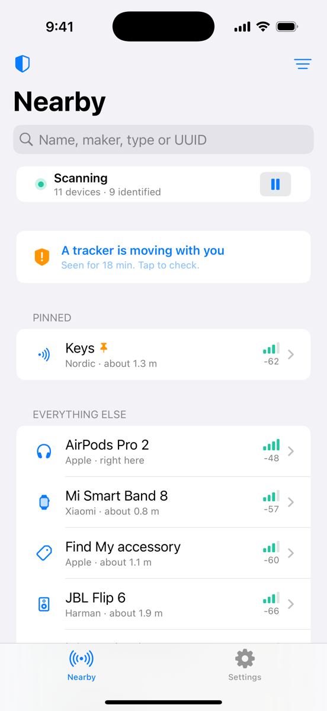
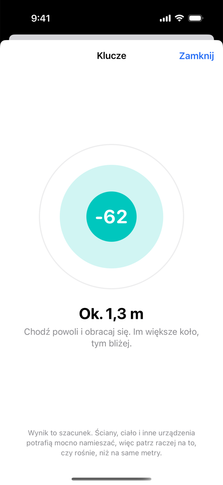
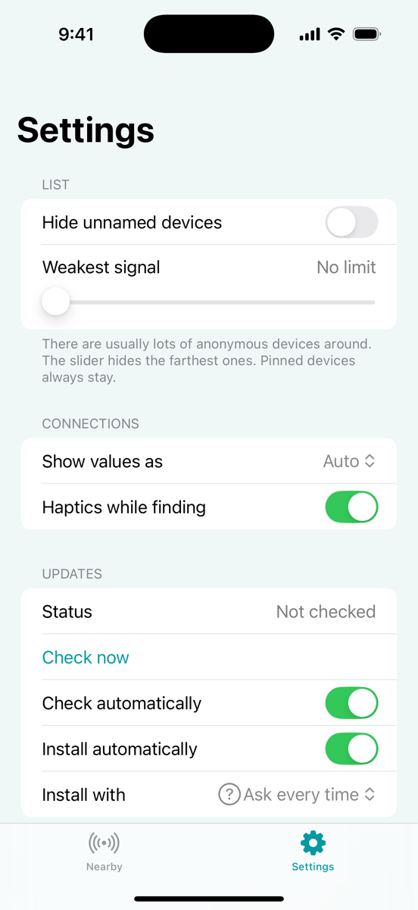
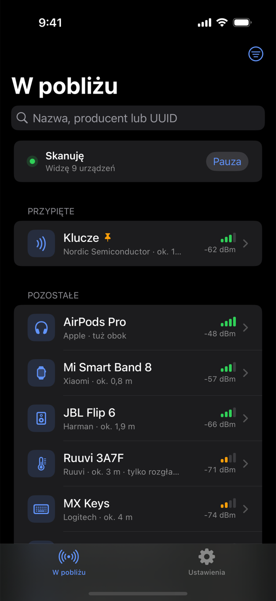

<div align="center">
  
  <h1>BlueTools</h1>
  <p><i>Skaner Bluetooth LE na iPhone'a. Zobacz, co nadaje w pobliżu, połącz się i zajrzyj do środka.</i></p>
</div>

<h3 align="center">
  <a href="https://altdirect.app/?url=https://github.com/OnlineKot/BlueTools/releases/latest/download/source.json" target="_blank"></a>
  &nbsp;
  <a href="https://github.com/OnlineKot/BlueTools/releases/latest/download/BlueTools.ipa" target="_blank"></a>
</h3>

<p align="center">
  
  
  
  
</p>

BlueTools jest za darmo i ma otwarty kod. Nie ma w nim reklam, kont ani analityki, a jedyne, o co pyta internet, to numer najnowszej wersji na GitHubie.

## Co umie

- Pokazuje urządzenia w pobliżu z siłą sygnału, przybliżoną odległością i producentem (jeśli da się go rozpoznać z rozgłoszenia).
- Łączy się z urządzeniem i pokazuje jego usługi i charakterystyki. Możesz je odczytać, zapisać (tekstem albo w hex) i nasłuchiwać powiadomień. Wszystko trafia do historii.
- Ma tryb szukania: kółko rośnie, kiedy podchodzisz bliżej. Przydaje się, kiedy słuchawka wpadnie pod kanapę.
- Pozwala przypiąć urządzenie i nadać mu własną nazwę, żeby „Bez nazwy” stało się na przykład „Kluczami”.
- Sam sprawdza, czy wyszła nowa wersja (można to wyłączyć w ustawieniach).

## Instalacja

Wymagany jest iOS 16 lub nowszy.

### SideStore albo LiveContainer

Kliknij na iPhonie **Add AltSource** u góry i wybierz swoją aplikację. Możesz też dodać źródło ręcznie: w SideStore wejdź w **Sources**, a w LiveContainer w ustawienia źródeł, i wklej:

```
https://github.com/OnlineKot/BlueTools/releases/latest/download/source.json
```

Po dodaniu źródła nowe wersje pokażą się same.

### Ręcznie

Pobierz `BlueTools.ipa` z [najnowszego wydania](https://github.com/OnlineKot/BlueTools/releases/latest) i zainstaluj przez Sideloadly, AltStore albo TrollStore. IPA nie jest podpisane, więc przy darmowym Apple ID trzeba je odświeżać co 7 dni.

## Budowanie

Potrzebujesz Maca z Xcode 15+ i [XcodeGen](https://github.com/yonaskolb/XcodeGen):

```sh
brew install xcodegen
xcodegen generate
open BlueTools.xcodeproj
```

Ustaw swój zespół w *Signing & Capabilities* i uruchom na telefonie. Symulator nie ma Bluetooth, ale po dodaniu argumentu `-demo` przy uruchomieniu apka pokaże przykładowe urządzenia. Tak powstają zrzuty ekranu wyżej.

`.xcodeproj` nie jest trzymany w repo. Generuje go XcodeGen z `project.yml`, więc nie ma konfliktów w `project.pbxproj`.

## Wydania

Przy każdym pushu GitHub Actions buduje niepodpisane IPA, a osobny workflow robi świeże zrzuty ekranu w symulatorze. Nowe wydanie powstaje z taga `v*` albo z commita, który ma w opisie `[release]`. Do wydania trafiają `BlueTools.ipa`, `source.json` i ikona. Opis zmian bierze się z `.github/release-notes.md`.

## Czego nie umie

- Odległość to tylko szacunek z siły sygnału. Ściana albo ręka na telefonie potrafią ją zmienić o kilka metrów.
- iOS nie pokazuje prawdziwych adresów MAC. Identyfikator nadaje system i na każdym telefonie jest inny.
- Sprzęt Apple co jakiś czas zmienia adres (to celowe, chodzi o prywatność), więc potrafi zniknąć z listy i wrócić jako nowe urządzenie.
- Klasyczny Bluetooth, czyli stare głośniki i samochody, jest dla iOS niewidoczny. Działa tylko BLE.

## Pomoc mile widziana

Jeśli coś u ciebie wyświetla się jako „Bez nazwy”, a wiesz, co to jest, dopisz producenta albo UUID w `BlueTools/Models/KnownIDs.swift` i wyślij PR. Błędy zgłaszaj w [Issues](https://github.com/OnlineKot/BlueTools/issues).

## Licencja

[GPL-3.0](LICENSE). Przyciski do dodawania źródła pochodzą z [AltDirect](https://github.com/StikDebug/altdirect).
