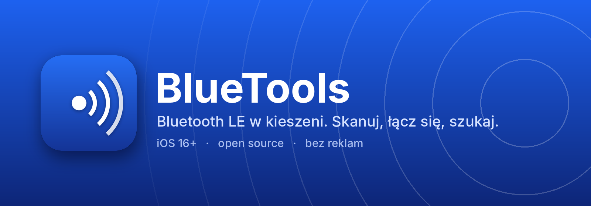

<p align="center">
  
</p>

<p align="center">
  <a href="https://github.com/OnlineKot/BlueTools/releases/latest"></a>
  <a href="https://github.com/OnlineKot/BlueTools/releases"></a>
  
  
  <a href="LICENSE"></a>
</p>

<p align="center">
  Mała apka na iPhone'a do grzebania w Bluetooth LE.<br>
  Widzisz, co jest wokół, łączysz się z tym i zaglądasz do środka.<br>
  A kiedy słuchawka wpadnie pod kanapę, pomaga ją znaleźć.
</p>

<h3 align="center">
  <a href="https://altdirect.app/?url=https://github.com/OnlineKot/BlueTools/releases/latest/download/source.json&r=sidestore"></a>
  &nbsp;
  <a href="https://altdirect.app/?url=https://github.com/OnlineKot/BlueTools/releases/latest/download/source.json&r=livecontainer"></a>
  &nbsp;
  <a href="https://github.com/OnlineKot/BlueTools/releases/latest/download/BlueTools.ipa"></a>
</h3>

<p align="center"><sub>Przyciski otwórz na iPhonie, wtedy od razu przeniosą cię do aplikacji.</sub></p>

---

## Co potrafi

<table>
  <tr>
    <td width="64" align="center"></td>
    <td><b>Lista urządzeń w pobliżu</b><br>Siła sygnału, przybliżona odległość i producent, jeśli da się go rozpoznać. Do tego wyszukiwarka, sortowanie i filtr na anonimowe śmieci.</td>
  </tr>
  <tr>
    <td align="center"></td>
    <td><b>Połączenie i podgląd</b><br>Usługi, charakterystyki, odczyt, zapis (tekst albo hex) i nasłuchiwanie powiadomień. Wszystko ląduje w historii, więc widać, co przyszło, a co poszło.</td>
  </tr>
  <tr>
    <td align="center"></td>
    <td><b>Tryb szukania</b><br>Kółko rośnie, im jesteś bliżej, a telefon lekko wibruje, kiedy robi się cieplej. Ekran przy tym nie gaśnie.</td>
  </tr>
  <tr>
    <td align="center"></td>
    <td><b>Przypinanie i własne nazwy</b><br>Losowe „Bez nazwy” możesz nazwać po swojemu, np. „Klucze” albo „Głośnik w kuchni”. Przypięte są zawsze na górze.</td>
  </tr>
  <tr>
    <td align="center"></td>
    <td><b>Aktualizacje</b><br>Apka sama sprawdza, czy wyszła nowa wersja, pokazuje, co się zmieniło, i podsuwa, jak ją zainstalować. Można to wyłączyć w ustawieniach.</td>
  </tr>
  <tr>
    <td align="center"></td>
    <td><b>Bez śledzenia</b><br>Zero reklam, kont i analityki. Jedyne, o co apka pyta internet, to numer najnowszej wersji na GitHubie.</td>
  </tr>
</table>

## Instalacja

### SideStore

Najwygodniej. Dodajesz źródło raz, a potem aktualizacje przychodzą same.

1. Na iPhonie kliknij **Dodaj źródło do SideStore** wyżej.
2. Albo wejdź w SideStore → **Sources** → **+** i wklej:

```
https://github.com/OnlineKot/BlueTools/releases/latest/download/source.json
```

3. Znajdź BlueTools na liście i stuknij **Free**.

### LiveContainer

1. Kliknij **Dodaj źródło do LiveContainer** albo dodaj ręcznie ten sam adres:

```
https://github.com/OnlineKot/BlueTools/releases/latest/download/source.json
```

2. Zainstaluj BlueTools ze źródła i uruchom go w LiveContainerze.

### Inne sposoby

Plik IPA jest zawsze w [najnowszym wydaniu](https://github.com/OnlineKot/BlueTools/releases/latest). Nadaje się do:

- [AltStore](https://altstore.io) (wersja klasyczna, też przyjmie to źródło),
- [Sideloadly](https://sideloadly.io) z komputera,
- TrollStore, jeśli masz telefon i wersję iOS, które go obsługują.

> [!NOTE]
> IPA nie jest podpisane. Przy darmowym Apple ID SideStore i AltStore muszą odświeżać aplikację co 7 dni, tak już po prostu działa Apple.

Wymagany jest iOS 16 albo nowszy.

## Budowanie samemu

Potrzebujesz Maca z Xcode 15+ i [XcodeGen](https://github.com/yonaskolb/XcodeGen).

```sh
brew install xcodegen
xcodegen generate
open BlueTools.xcodeproj
```

W Xcode wybierz swój zespół w *Signing & Capabilities* i odpal na telefonie. Symulator nie ma Bluetooth, więc tam za wiele nie zobaczysz.

Samo IPA bez podpisu, tak jak robi to CI:

```sh
xcodebuild -project BlueTools.xcodeproj -scheme BlueTools \
  -configuration Release -sdk iphoneos -destination 'generic/platform=iOS' \
  -derivedDataPath build CODE_SIGNING_ALLOWED=NO build
mkdir Payload && cp -R build/Build/Products/Release-iphoneos/BlueTools.app Payload/
zip -qry BlueTools.ipa Payload
```

## Jak wychodzą nowe wersje

Wystarczy wypchnąć tag, np. `v1.2.0`. GitHub Actions zbuduje IPA, ustawi w nim ten numer wersji i wrzuci do wydania cztery pliki: `BlueTools.ipa`, `source.json`, ikonę i baner. Opis zmian bierze się z pliku `.github/release-notes.md`, więc przed tagiem warto go poprawić.

`source.json` zawsze leży pod tym samym adresem (`releases/latest/download`), więc SideStore, LiveContainer i sama apka od razu widzą nową wersję.

## Jak to jest poukładane

```
BlueTools/
  App/          start aplikacji i zakładki
  Bluetooth/    skanowanie i obsługa połączenia (CoreBluetooth)
  Models/       urządzenie z listy i słownik znanych identyfikatorów
  Views/        ekrany w SwiftUI
  Support/      hex, ustawienia, przypięte urządzenia, aktualizacje
scripts/        generator source.json dla SideStore i LiveContainer
project.yml     opis projektu dla XcodeGen
```

Plik `.xcodeproj` nie siedzi w repo, generuje go XcodeGen. Dzięki temu nie ma konfliktów w tym okropnym `project.pbxproj`.

## Parę uczciwych uwag

- Odległość to szacunek z siły sygnału. Ściana, kieszeń albo twoja ręka potrafią zmienić wynik o kilka metrów, więc w trybie szukania patrz raczej na to, czy rośnie.
- iOS nie pokazuje prawdziwych adresów MAC. Identyfikator, który widzisz, nadaje system i jest inny na każdym telefonie.
- Słuchawki i zegarki Apple co jakiś czas zmieniają adres (celowo, dla prywatności), więc potrafią znikać i wracać jako nowe.
- Klasyczny Bluetooth (stare głośniki, samochody) nie jest widoczny przez CoreBluetooth. Apka widzi tylko BLE.

## Chcesz pomóc?

Zgłoszenia i pull requesty są mile widziane. Najbardziej przydadzą się kolejne UUID i identyfikatory producentów w `Models/KnownIDs.swift`. Jeśli coś u ciebie wyświetla się jako „Bez nazwy”, a wiesz, co to jest, daj znać.

## Licencja

GPL-3.0. Pełny tekst jest w pliku [LICENSE](LICENSE).

<sub>Przyciski „Dodaj do…” przekierowują przez [AltDirect](https://altdirect.app), bo GitHub nie pozwala w README na linki typu `sidestore://`.</sub>
